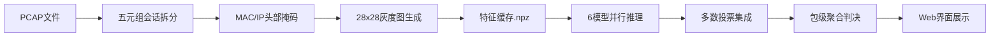

# 基于深度学习的加密流量快速入侵检测系统

## 软件说明书

---

**硬件环境：**

开发：CPU：Intel Core i9-13900H（14核20线程）；内存：32GB；磁盘：1TB NVMe SSD。

运行：CPU：Intel Core i9-13900H；内存：32GB；磁盘：1TB NVMe SSD。

**软件环境：**

开发：Windows 11 家庭中文版（Build 22631），Python 3.11.9，PyTorch 2.6.0（CUDA 12.4），FastAPI 0.x，Uvicorn，Visual Studio Code；

运行：Windows 10/11，Linux Ubuntu 20/22；Python 3.11+，PyTorch 2.x（CPU/GPU均可），Scapy（Windows需安装Npcap用于实时抓包）；

**源程序量：8732行**

---

**开发目的（50字以内）：** 本软件基于深度学习和多模型集成策略，实现对加密网络流量的快速入侵检测与恶意流量识别。

**面向领域/行业：** 属于信息安全领域的关键产品，面向政府、教育、企业等行业的网络安全运维与威胁检测场景。

---

**主要功能（500-1300字符）：**

本系统是一款基于深度学习的加密流量入侵检测工具，旨在帮助网络安全运维人员、渗透测试工程师及安全分析师，无需解密即可对加密网络流量进行恶意行为识别。系统的核心思想是将原始PCAP流量文件转化为28×28灰度图像，利用多种深度学习模型进行二分类（正常/恶意），并通过多模型集成投票策略输出最终判决。

在系统整体架构设计上，采用了高内聚、低耦合的模块化架构。具体而言，系统由多个功能模块共同构成：

**（1）PCAP数据预处理模块**

支持单文件上传与批量文件处理两种模式。系统读取原始PCAP文件，按五元组（源IP、源端口、目的IP、目的端口、协议）将混杂流量拆分为独立双向会话。每个会话截取前28个数据包、每包前28字节的有效载荷，填入28×28的uint8矩阵，生成流量灰度图。训练阶段可选用MAC/IP头部掩码机制，将以太网和IP头部字节统一置为固定值，降低模型对地址信息的过拟合，迫使模型聚焦于应用层特征。

**（2）多模型训练与评估模块**

系统内置6种深度学习模型：CNN-BiLSTM（卷积双向长短期记忆网络）、Classic CNN（经典卷积神经网络）、Lightweight CNN-BiLSTM（轻量化混合模型，参数量仅为标准版的1/5）、Pure BiLSTM（纯双向LSTM）、MLP（三层多层感知机）以及Transformer（基于自注意力机制的编码器模型）。支持Focal Loss损失函数与类别权重调节，有效缓解正常/恶意样本不平衡问题。训练过程自动保存最优模型权重，并计算准确率、精确率、召回率、F1分数、AUC、误报率、漏报率及推理吞吐量等综合指标。

**（3）多模型集成推理模块**

推理阶段，6个模型并行预测，采用多数投票策略结合各模型独立恶意判决阈值进行综合判定。每个模型设有独立的恶意阈值参数（如CNN-BiLSTM阈值为0.65，Transformer阈值为0.35），充分考虑了不同模型在数据集上的置信度分布差异。支持PCAP包级聚合策略：当被标记为恶意的会话占比或绝对数量达到预设阈值时，将整个PCAP判定为恶意，并可配置包级置信度阈值进行二次过滤，有效抑制误报。

**（4）实时抓包检测模块**

集成Scapy网络嗅探能力，支持从本地网卡实时捕获流量数据包。用户可在Web界面配置抓包参数（网卡接口、抓包数量、超时时间），系统自动将捕获的流量转为灰度图并送入模型进行实时推理，实现网络流量的在线入侵检测。

**（5）特征缓存加速模块**

系统在首次处理PCAP文件后，自动将提取的会话图像保存为.npz格式的特征缓存文件。后续训练或推理时直接读取缓存，大幅缩短数据准备时间。缓存键基于文件路径、修改时间和文件大小生成SHA-256哈希值，确保缓存与源文件的一致性。

**（6）Web可视化管理平台**

基于FastAPI后端框架与Jinja2模板引擎构建，前端采用Tailwind CSS设计语言和ECharts可视化图表库，提供赛博朋克风格的深色主题界面。支持用户登录认证（基于Cookie的会话管理）、文件拖拽上传与批量检测、检测结果多维度展示（模型名称、恶意概率、置信度、会话统计）、混淆矩阵可视化、检测历史记录查询及实时系统状态监控。推理结果同时包含各独立模型的预测结论与集成投票的最终判决，便于安全分析人员对比评估不同模型的表现。

综上所述，本系统以PCAP灰度图像化思路为核心创新点，结合6种深度学习模型的多维度集成策略与完善的Web管理平台，构建了一套功能全面、架构清晰、检测高效的加密流量入侵检测工具，能够在不解密流量的前提下，有效支撑各类网络环境下的恶意流量识别与安全威胁评估工作。

---

**技术特点（100字符）：** 前端Tailwind+ECharts提供可视化界面，后端FastAPI提供RESTful API。六大深度学习模型集成投票，支持PCAP灰度图转换与实时抓包检测。

---

Web管理平台使用FastAPI框架构建，结合Jinja2模板引擎提供用户界面。前端通过原生Fetch API与后端API进行通信，后端使用Python语言开发，提供RESTful API服务。模型推理基于PyTorch深度学习框架，6个模型并行加载与预测。前端采用Tailwind CSS实现响应式布局与暗色主题，ECharts用于检测结果的饼图、柱状图等多维度可视化展示。系统的前、后端可独立开发和部署，通过API接口进行数据交互，模型层与Web层解耦，确保了系统的模块化和可扩展性。

---

## 系统架构说明

### 整体技术栈

| 层级 | 技术选型 | 说明 |
|------|---------|------|
| 前端展示 | HTML5 + Tailwind CSS + ECharts + JavaScript | 赛博朋克风格暗色主题，响应式布局 |
| 后端服务 | FastAPI + Uvicorn + Jinja2 | 高性能异步Web框架，模板引擎渲染 |
| 深度学习 | PyTorch + torchvision | 6种模型定义、训练与推理 |
| 网络处理 | Scapy + RawPcapReader | 离线PCAP解析与在线实时抓包 |
| 数据处理 | NumPy + Pillow + scikit-learn | 灰度图生成、特征缓存与指标计算 |

### 核心处理流程

### 6大模型对比

| 模型名称 | 核心结构 | 参数量 | 特点 |
|---------|---------|--------|------|
| CNN-BiLSTM | Conv1d + BiLSTM | 中等 | 主力模型，兼顾局部特征与上下文依赖 |
| Classic CNN | 多层Conv2d | 较小 | 纯卷积基线，训练快速 |
| Lightweight CNN-BiLSTM | 压缩版Conv1d + BiLSTM | 最小 | 标准版1/5参数量，适合边缘部署 |
| Pure BiLSTM | 纯双向LSTM | 较小 | 纯时序建模，无卷积结构 |
| MLP | 三层全连接 | 较大 | 传统神经网络基线（512-256-128） |
| Transformer | 多头自注意力编码器 | 最大 | 全局感受野，捕捉长距离依赖 |
